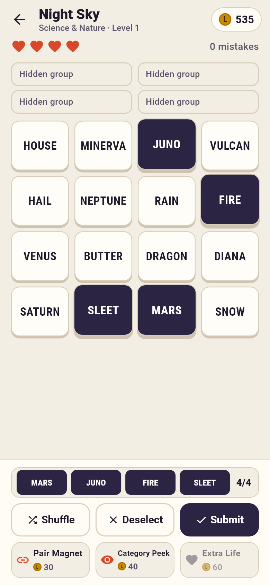
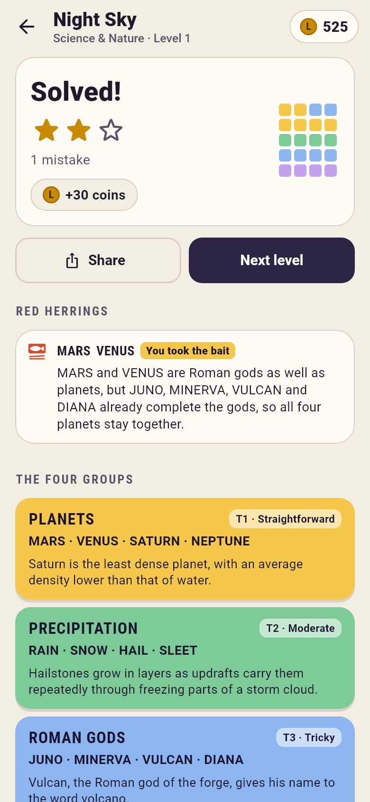
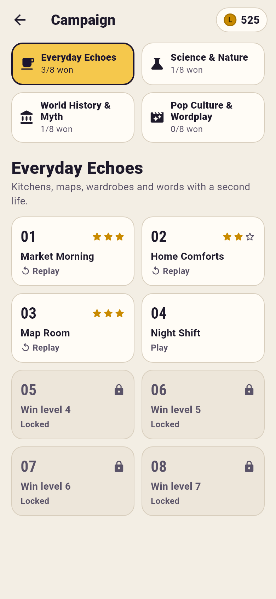

# LexiStack

An offline word-and-trivia grouping puzzle in pure Flutter/Dart. Each board hides
**four groups of four** among 16 shuffled tiles. Find all four before you run out of
four lives. Each group then reveals its title and a short trivia fact.

  

## How to play

- Tap tiles to select up to four (or long-press a tile and drag it onto another tile
  or onto the selection tray). **Submit** unlocks at 4/4.
- A correct guess locks the group as a colored banner. Tiers: 🟨 straightforward,
  🟩 moderate, 🟦 tricky, 🟪 lateral/wordplay.
- A wrong guess costs a life. **One Away!** means three of your four share a group.
  Re-submitting the same wrong set (in any order) is ignored: no life is lost.
- At zero lives the board waits for your decision. Buy an **Extra Life** or choose
  **Reveal answers & accept loss**. Nothing is revealed before that.
- Stars depend only on wrong submissions: 0 → ★★★, 1–2 → ★★, 3+ → ★. Rescues never
  improve stars.
- Every board has at least one documented **red herring**. The result screen
  explains it and flags the ones you fell for.

**Coins** start at 150. First win of a level pays 50/30/15 (3/2/1 stars). The first
replay win of a level pays +5 once. The Daily pays the star reward +25 once per date.
There are no other coin sources.

**Boosters:**
- Pair Magnet (30): reveals two tiles that belong together.
- Category Peek (40): reveals the lowest-tier hidden title.
- Extra Life (60): +1 life, up to 4, or rescues a pending loss.

Rejected boosters cost nothing.

**Daily Puzzle:** one attempt per local calendar date. The board comes from a
separate pool of 8 handcrafted daily-only levels, chosen as
`pool[civilDaysSince(2026-01-01) % poolSize]`. **The pool repeats every 8 days.**
Streaks count consecutive daily wins.

**Share** copies a spoiler-free emoji grid (no words, titles or facts) to the
clipboard.

## Architecture

```
lib/core/   pure Dart, no Flutter imports (shared with the CLI and tests)
  content.dart    pack/level model, tolerant JSON parser with located errors
  validator.dart  catalog-wide rules (strict / partial / candidate)
  game.dart       PuzzleGame: selection, submission, lives, boosters, result
                  state machine (playing / won / lostPendingDecision / lostFinal),
                  validated JSON save/restore
  prng.dart       Mulberry32 + FNV-1a in exact <2^53 integer math, so seeded
                  shuffles match on the Dart VM, Android and the web
  daily.dart      civil dates (UTC calendar arithmetic, DST-proof), streaks
  scoring.dart    stars, rewards, booster prices, share text
lib/app/    AppController (ChangeNotifier): economy, unlocks, daily rules, stats,
            persistence; PlayerProgress (one versioned JSON document);
            ProgressStore (shared_preferences or in-memory)
lib/ui/     screens (home, packs, board, result, stats, settings), theme,
            desktop frame
assets/levels/  manifest.json + one JSON file per pack
tool/validate_levels.dart  standalone content validator
```

- **State management:** a single `ChangeNotifier`, exposed through an `InheritedNotifier`.
- **Packages:**
  - `shared_preferences` is the only runtime package.
  - `integration_test` (Flutter SDK) is a dev dependency for the on-device smoke test.
- **Fonts:** Roboto and Roboto Condensed are bundled from the Flutter SDK's font
  cache. They are under the Apache 2.0 license, in `assets/fonts/LICENSE-Roboto.txt`,
  and listed on the in-app license page.

## Offline storage and recovery

- **Single document:** all progress is one versioned JSON document in
  `shared_preferences`. That covers coins, best stars, payouts, finished-result
  summaries, daily outcomes, unfinished campaign and daily boards, and settings.
- **Write order:** writes are queued in order.
- **Write failures:** a failed write shows a small banner instead of pretending
  progress was saved.
- **Reset to defaults:** an unreadable document or a different `version` resets to
  safe defaults and shows a notice.
- **Partial salvage:** otherwise each field is salvaged on its own. A damaged or
  orphaned unfinished board is dropped without touching coins, stars or history.
  Orphaned means its level was removed from the content files. Saved boards are
  checked against the level before they are used.
- **Reload safety:** reloading resumes the same board, with the same order,
  selection, hints and lives. Paid hints are not rerolled, and results are never
  counted or paid twice.
- **Web:** after the first load the game itself runs offline. Repeat offline visits
  depend on the browser's cache.

## Windows setup and commands

Requires the Flutter stable SDK (3.47 tested). For Android you also need the Android
SDK and a JDK. Run these from the repository root in PowerShell:

```powershell
flutter pub get
dart run tool/validate_levels.dart          # strict final content check
dart analyze
flutter test                                # unit, controller and widget tests
flutter test test/ui/screenshots_test.dart --dart-define=SCREENSHOTS=true   # refresh docs/screenshots
flutter build web
flutter build apk --debug
flutter run -d chrome                       # or: flutter run -d <android-device>
flutter test integration_test/app_smoke_test.dart -d emulator-5554        # on-device smoke test
```

`flutter build windows` needs Visual Studio with "Desktop development with C++".

## Adding content (including AI-generated packs)

Each pack file has this shape:

```json
{ "schemaVersion": 2,
  "pack": { "id": "pack5", "title": "...", "description": "..." },
  "levels": [ /* exactly 8 */ {
    "id": "pack5_lvl01", "packId": "pack5", "title": "...",
    "categories": [ /* one per tier 1-4 */ {
      "id": "g1", "title": "...", "difficultyTier": 1,
      "tiles": ["FOUR", "UPPERCASE", "WORDS", "HERE"],
      "triviaFact": "One sentence of 40-160 characters." } ],
    "redHerrings": [ { "tiles": ["WORDS"], "note": "Why it looks like it fits elsewhere..." } ]
  } ] }
```

1. **Check the candidate.** Run `dart run tool/validate_levels.dart path\to\pack5.json`.
   The candidate is checked against the installed catalog and reported as a
   **REPLACEMENT** (same pack ID) or an **ADDITION**. Production files are never
   modified.
2. **Install it.** Copy the file to `assets/levels/` and add it to
   `manifest.json` → `"campaign"`. Daily boards go in a separate file; `"daily"`
   accepts one file name or a list.
3. **While building content,** run `dart run tool/validate_levels.dart --partial`.
   It checks only the listed files that exist, so unfinished packs don't fail it.
4. **Before shipping,** run `dart run tool/validate_levels.dart`. Strict mode needs
   ≥4 campaign packs of 8 levels and a daily pool of ≥8, with zero errors.
   Aim for zero warnings.

**Errors** cover:
- schema and types, counts and tiers
- duplicate IDs, titles and tiles
- tile format: uppercase, at most two words of at most 10 letters
- fact length and single-sentence form
- red-herring references
- the reuse limits: a tile in at most two levels, and no two groups sharing three
  or more tiles

**Warnings** flag:
- a fact that names another group's tile on the same board
- a red-herring note that doesn't mention its tile

The validator cannot prove that a board has only one sensible solution. Review new
boards by hand for alternative groupings.
